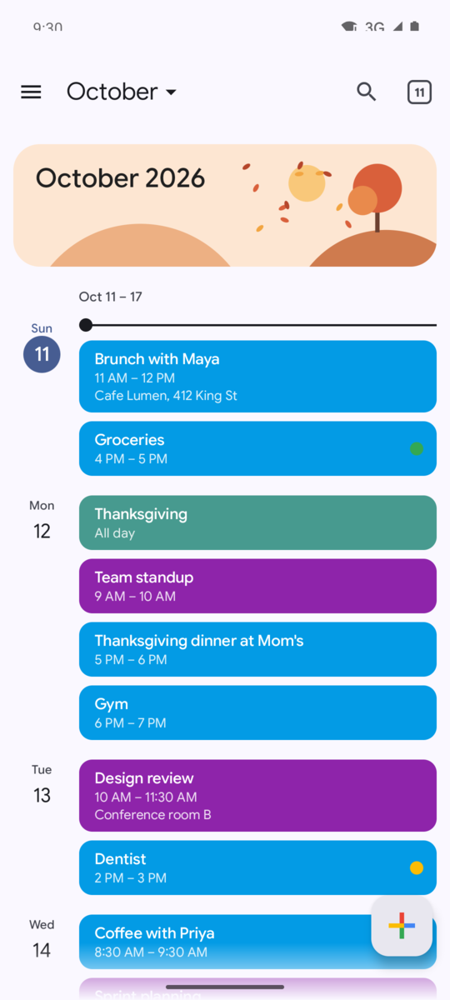
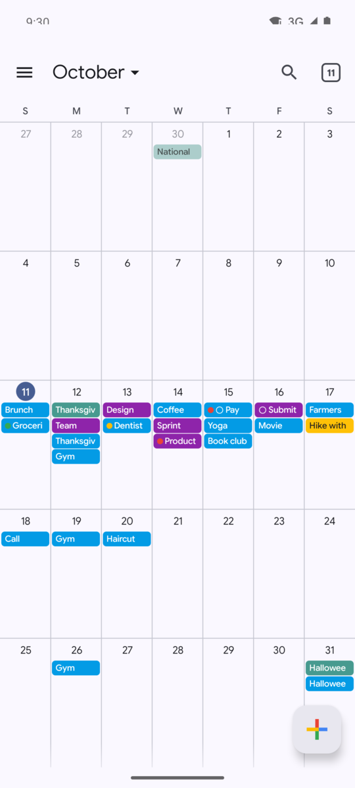
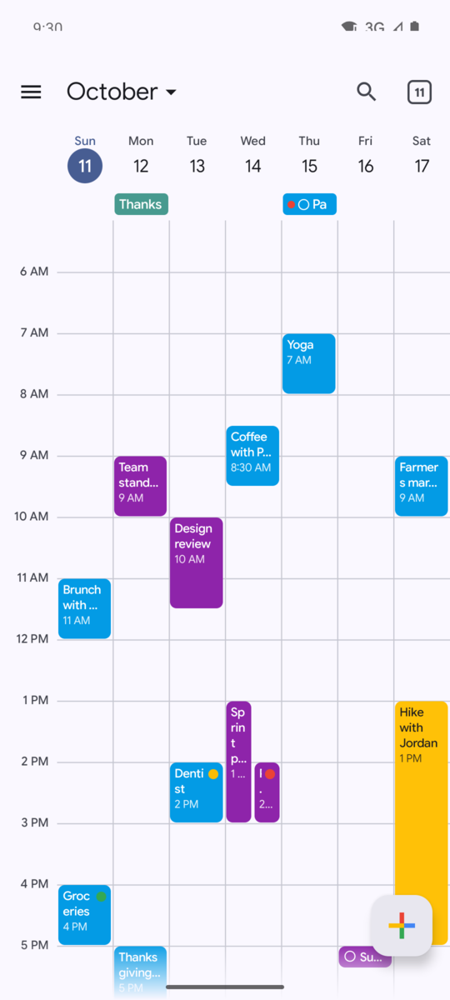
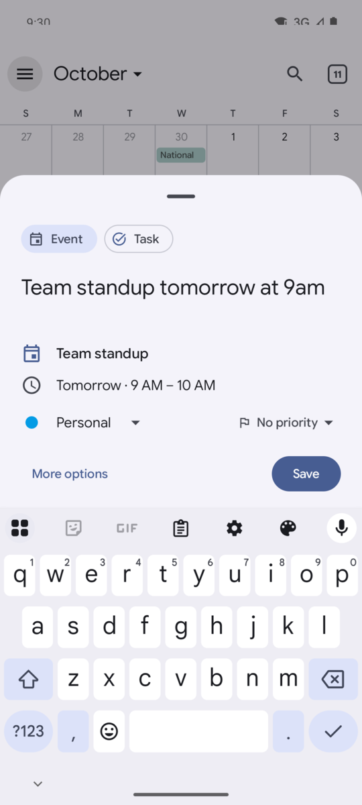
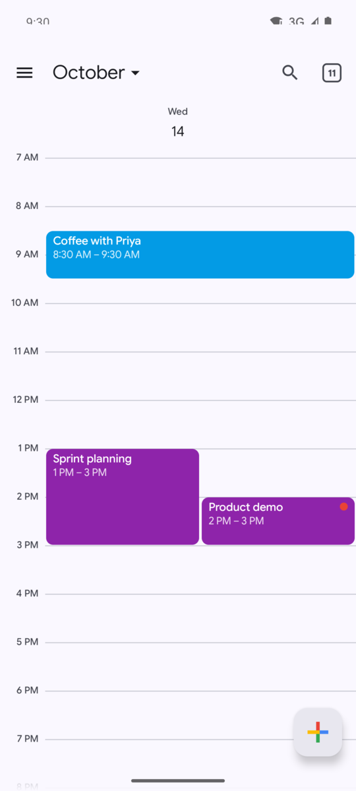
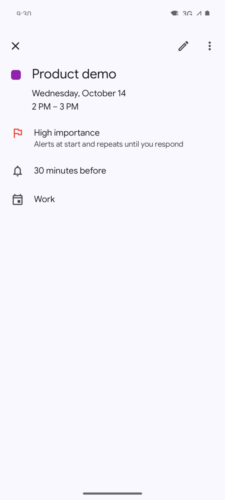
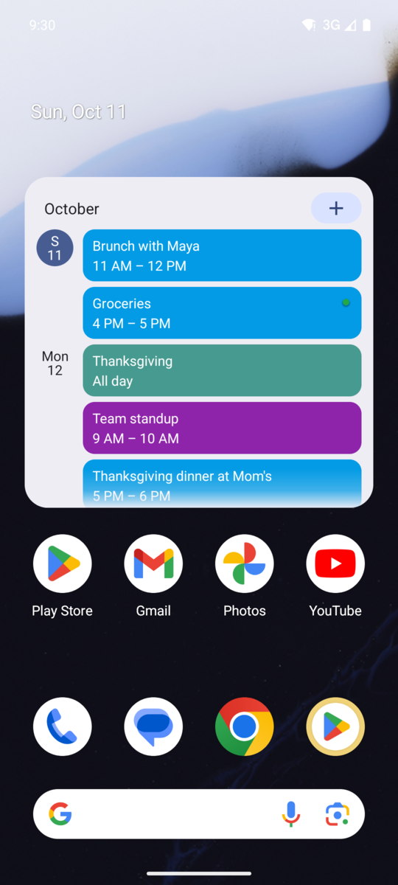
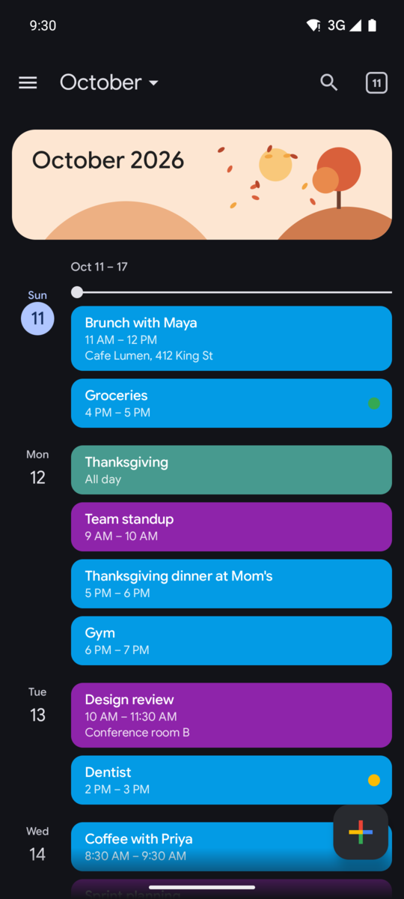
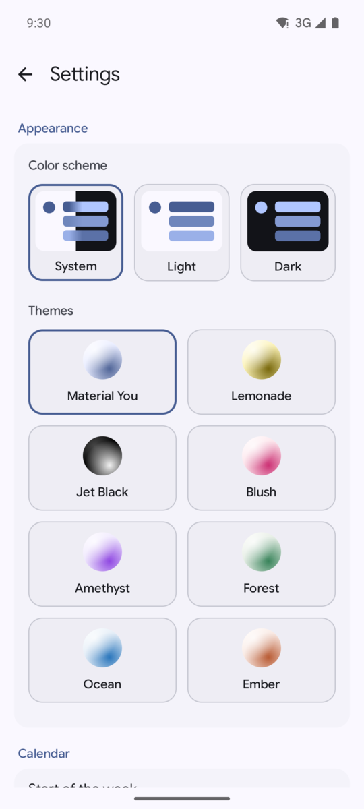
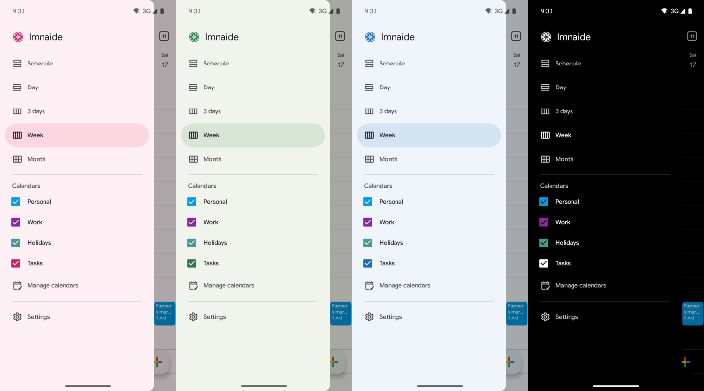

# lmnaide Calendar

An offline Android calendar built with Jetpack Compose and Material 3. It works like Google Calendar and looks like it too, with Material You colors, Google Sans Flex type, solid event chips and illustrated month banners. Nothing leaves your phone. There are no accounts and no sync.

Created in [T3 Code](https://t3.codes). [DESIGN.md](DESIGN.md) covers the design system.

<p>
  
  
  
  
</p>

## Features

### Views

The app has five views: Schedule, Day, 3 days, Week and Month. Swipe left or right to change the period. Tap the month name for a date picker, and tap the date button in the top bar to jump back to today.

Overlapping events sit side by side, and multi-day events stretch across the days they cover. Past events are dimmed, and a line marks the current time.

<p>
  
  
  
  
</p>

### Quick add

Tap + and type a sentence such as "Lunch with Sam tomorrow at noon" or "Pay rent by Friday". The parser runs offline and previews the title, day, time and repeat as you type. Press Save or the keyboard's Done key to add it. More options opens the full editor with those fields filled in.

- Sentences with "by" become tasks. You can also pick Event or Task yourself.
- It understands relative and exact dates, 12- and 24-hour times, time ranges that cross midnight, durations, and common repeats like "every Monday".
- Date ranges such as "Oct 23 to Oct 25", "Oct 23-25" or "Fri to Sun" become multi-day events.
- If you give a time but no day, the event goes on the day you're looking at.
- If the wording is unclear, the sheet asks for more detail instead of guessing.
- New events use your default duration and reminders.

Quick add picks a calendar in this order:

1. A keyword match. Set keywords per calendar in Manage calendars, for example "produce, shift" on Work.
2. The calendar you used last time for the same title.
3. A calendar whose name appears in the text.
4. Your default calendar.

Tap the calendar in the preview to change it before saving.

### Events and tasks

Events have a title, a start and end (timed, all-day or multi-day), a location that opens in your maps app, a description, a color and a calendar.

Tasks have a due date with an optional time and can repeat. Check them off from the schedule, the task page or the notification. Each occurrence of a repeating task is checked off separately. You can create a task from the + menu or switch any event to a task. A toggle in the drawer shows or hides tasks.

Events and tasks can repeat daily, every weekday, weekly, monthly or yearly, with an optional end date. When you edit or delete a repeating item, you choose between this one, this and following, or all of them.

### People

Add device contacts to an event from quick add or the editor. In quick add, names after "with" are matched against your contacts. For example, "Movie night with Sam, Dario and I on the 10th at 7pm" adds Sam and Dario. If a name matches more than one contact, the app asks which one you mean. "I" is skipped. Tap a name in the event details to open that contact.

People are stored on the device only. The app never sends invitations.

### Importance and reminders

Mark any event or task as Low (green), Medium (yellow) or High (red). Each level notifies you differently:

| Level  | Notification |
|--------|--------------|
| Low    | Silent. It waits in the notification shade. |
| Medium | Normal sound, with a Snooze button. |
| High   | Strong vibration and an extra alert at the start or due time. It repeats every 5 minutes, up to 3 times, until you tap Got it, snooze, open the event or finish the task. |

Each calendar can also have a default importance, which new events on that calendar start with.

Each event can have several reminders. They use exact alarms, so they fire on time, and the app reschedules them after a reboot or a time zone change.

### Calendars

Create, rename, recolor and delete calendars from Manage calendars. Show or hide each one from the drawer. A Holidays calendar comes preloaded with Canadian holidays.

### Search

Search matches event titles, locations and descriptions.

### Home-screen widget

The Calendar agenda widget shows upcoming days with date badges, colored event cards, open tasks and importance dots. Tap a card to open the event, or tap + to add one. The widget resizes, scrolls and follows the app's light or dark setting. It updates when events, tasks, calendar visibility or settings change.

To add it, long-press your home screen, open Widgets and pick Calendar agenda.

### Themes and settings

Choose System, Light or Dark, then pick one of eight themes: Material You (colors from your wallpaper, the default), Lemonade, Jet Black, Blush, Amethyst, Forest, Ocean or Ember. Jet Black is always dark.

<p>
  
  
</p>

Settings also covers the first day of the week, 24-hour time, and the default calendar, event length and reminder.

## Building

You need JDK 17 and the Android SDK with platform 37. Gradle downloads the right JDK on its own, as set in `gradle/gradle-daemon-jvm.properties`.

```sh
./gradlew assembleDebug   # builds app/build/outputs/apk/debug/app-debug.apk
./gradlew installDebug    # installs on a connected device or emulator
```

The app runs on Android 8.0 (API 26) and later.

## Project layout

```
app/src/main/java/dev/lmnaide/calendar/
├── data/        Room entities, DAOs, repository, settings (SharedPreferences)
├── domain/      Occurrence model, recurrence expansion, event index
├── reminders/   Exact-alarm scheduler and broadcast receiver
└── ui/
    ├── main/        Drawer, top bar, month, time grid and schedule views, mini month
    ├── event/       Event details and editor
    ├── search/      Search
    ├── settings/    Settings
    ├── calendars/   Calendar management
    ├── common/      Shared components, dialogs, formatting
    └── theme/       Material 3 color schemes and typography
```

Timed events are stored as UTC instants. All-day events are stored as plain dates with no time zone, so they stay on the same day when you travel. A repeating event is stored once, and the app expands it into individual occurrences for the dates on screen.

## Third-party assets

Google Sans Flex is bundled under the SIL Open Font License. See `third_party/google-sans-flex/OFL.txt`.
